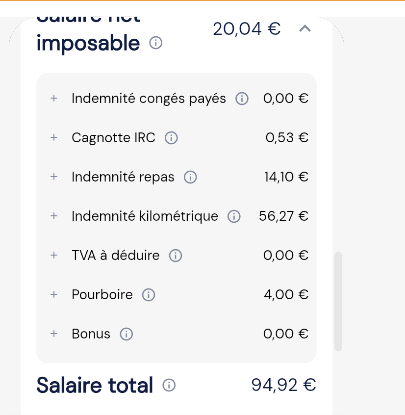
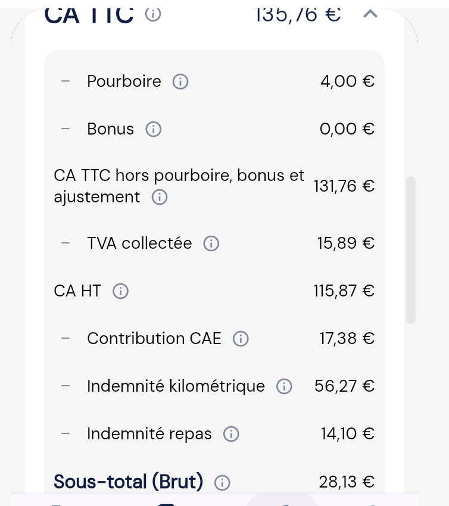

# Les Congés Payés

<aside>
📌

**En bref.** Les congés payés (CP) ne peuvent plus être mis de côté (maintien) : ils sont directement inclus dans la rémunération du chauffeur, versée au fil de l'eau (versement). Plus de cagnotte, plus de maintien, plus de ligne « indemnité compensatrice de congés payés » (ICP). 

</aside>

### **Comprendre le nouveau fonctionnement**

- **Un seul mode : le versement.** Il n'y a plus de choix entre maintien (cagnotte) et versement. Tout le monde est en versement.
- **Les CP sont inclus dans le salaire.** Le salaire net du chauffeur est augmenté du montant de ses CP, et versé au même rythme que le reste de sa rémunération.
- **Exemple :** avant, 100 € de salaire net + 10 € de CP sur une ligne à part (ou mis en cagnotte pour ceux en maintien). Maintenant, 110 € de salaire net directement, sans ligne à part. Le montant total est le même.
- **Les CP ne se « posent » pas.** Chaque mois, le chauffeur acquiert 2,5 jours de CP (30 jours ouvrables par an) et ces 2,5 jours sont considérés comme pris et payés sur la fiche de paie du mois. C'est comme si chaque chauffeur partait 2,5 jours en vacances tous les mois.
- **Combien valent les CP ?** 10 % de ce que le chauffeur a gagné, comme avant. Les 2,5 jours sont les mêmes pour tous, leur valeur dépend de la rémunération : un chauffeur qui gagne 1 000 € a 100 € de CP, un chauffeur qui gagne 2 000 € en a 200 €.

<aside>
🔒

**Pour votre culture, à ne pas expliquer aux chauffeurs.** Techniquement, on applique la méthode du dixième : l'unité d'œuvre a été réduite de 10 %, ce qui augmente le nombre d'heures déclarées pour un même CA, et donc le salaire net de 10 %. C'est de la mécanique interne : face au chauffeur, on retient uniquement « tes CP sont inclus dans ton salaire ».

</aside>

### **Comment sont calculés les CP ? Exemple concret**

**La règle :** les CP valent **10 % du salaire hors CP** (méthode du dixième). Comme ils sont maintenant inclus dans le salaire, pour retrouver la part de CP dans un salaire (brut ou net), on le **divise par 11**.

**Exemple : un chauffeur dont le salaire du mois, hors CP, est de 1 000 €.**

| Étape | Calcul | Montant |
| --- | --- | --- |
| Salaire net du mois, hors CP |  | 1 000 € |
| CP du mois | 10 % × 1 000 € | 100 € |
| **Salaire net versé au chauffeur** | 1 000 € + 100 € | **1 100 €** |
| Jours de CP sur le bulletin |  | 2,5 acquis, 2,5 pris |
| Valeur d'un jour de CP | 100 € ÷ 2,5 jours | 40 € / jour |

**Avant / maintenant, pour ce même chauffeur :**

- **Avant :** 1 000 € de salaire + 100 € d'ICP sur une ligne à part (ou 100 € mis en cagnotte s'il était en maintien).
- **Maintenant :** 1 100 € de salaire net, sans ligne à part. Les 100 € de CP sont dedans.
- **Au total, il touche la même somme : 1 100 €.** Seule la présentation change.

**Retrouver les CP à partir d'un salaire net :** 1 100 € ÷ 11 = 100 € de CP, et donc 1 000 € de salaire.

| Ligne de l'app | Ce que c'est | Exemple (captures ci-dessous) | Dont CP (÷ 11) |
| --- | --- | --- | --- |
| Sous-total (Brut) | Salaire brut, CP inclus | 28,13 € | 2,56 € |
| Salaire net imposable | Salaire net, CP inclus | 20,04 € | 1,82 € |
| Indemnité congés payés | Ancienne ligne ICP, ne sert plus | 0,00 € |  |

### **Ce qui ne s'applique plus**

Si vous entendez ou lisez ces notions, elles correspondent à l'ancien fonctionnement :

- La cagnotte CP et le choix maintien / versement.
- La ligne ICP sur le bulletin.
- La provision des CP versée à la demande du chauffeur.

### **Où le voir ?**

- **Sur le bulletin de paie :** le compteur indique chaque mois 2,5 jours acquis et 2,5 jours pris. Le solde revient donc toujours à zéro, c'est normal. Il n'y a pas de ligne de montant dédiée aux CP.
- **Dans l'application :** l'ICP apparaît encore, à tort. L'affichage n'est pas encore à jour, la correction est demandée côté produit. En attendant, utiliser la macro ci-dessous.

### **Macro à utiliser**

Bonjour,
Nous avons fait évoluer la manière dont vos congés payés sont gérés et affichés. Jusqu'ici, selon l'option choisie, vos congés payés vous étaient versés au fil de l'eau, ou mis de côté chaque mois dans une cagnotte « congés payés » si vous étiez en maintien. Ce fonctionnement change : il n'y a plus de cagnotte ni de ligne séparée. Vos droits à congés payés continuent d'être suivis et vous restent intégralement acquis, rien n'est perdu. Le montant correspondant est désormais intégré à votre rémunération et vous est versé directement. Ce nouveau fonctionnement est déjà pris en compte dans vos comptes. 
Une question ? Notre équipe reste disponible via le chat.

### **Répondre aux demandes chauffeurs**

**« Prouvez-moi que mes CP sont bien payés. »**
Il n'y a pas de ligne dédiée, c'est voulu : vos CP sont inclus dans votre salaire. Pour le vérifier, comparez une fiche de paie d'avant le changement (ex. mai) et une d'après (ex. août) : pour un même chiffre d'affaires, votre salaire net est environ 10 % plus élevé. Ces 10 %, ce sont vos CP.

**« Où est le cumul de mes CP ? »**
Il n'y a plus de cumul : vos CP vous sont payés au fur et à mesure, rien n'est mis de côté. C'est pour ça que votre solde est à zéro chaque mois.

**« Où voir mes CP sur mon bulletin ? »**
Dans le compteur de congés de votre bulletin : 2,5 jours acquis et 2,5 jours pris chaque mois.

**« Mes CP sont en jours, comment ils sont convertis en euros ? »**
Les jours ne sont pas convertis : tout le monde acquiert 2,5 jours par mois. Leur valeur, c'est 10 % de votre salaire du mois, et ce montant est déjà inclus dans votre salaire. Par exemple, pour 1 000 € de salaire, vos CP valent 100 € : vous recevez 1 100 €, soit 40 € par jour de congé.

**« Pourquoi je vois encore une ligne ICP dans l'app ? »**
L'affichage de l'app n'est pas encore à jour, une correction arrive. Vos CP sont bien inclus dans votre salaire.
*Interne : envoyer la macro ci-dessus.*

#### Exemple dans l'app

Dans cet exemple, le Sous-total (Brut) est de 28,13 €, CP inclus. La part de CP est donc de 28,13 € ÷ 11 = 2,56 € (et non 2,81 €, qui serait 10 % d'un montant qui contient déjà les CP). Ils ne sont pas ajoutés à part dans l'ICP parce qu'ils sont déjà inclus dans le salaire : c'est pour ça que la ligne « Indemnité congés payés » est à 0,00 €. Cette ligne est un reste de l'ancien affichage.